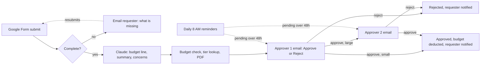

# AI Purchase Approval Agent


> **Staff submit a purchase request on a form. The agent checks it's complete, codes it to the right budget line,
> checks funds, routes it to the right approver with one-click Approve/Reject buttons, generates the paperwork, and
> chases anyone who's holding it up.**

A complete purchase-request workflow built on Google Forms, Sheets, and Docs, with Claude handling the judgment
calls: which budget line, a plain-English summary, and red flags. Approvals happen from one-click email buttons backed
by signed, single-use links. Routing thresholds, budgets, and approvers all live in a spreadsheet the client
controls.

---

## What it does

| | |
|---|---|
| 📝 **Intake** | A Google Form collects requester, item, vendor, cost, need-by date, and justification |
| 🔍 **Validates** | Missing details? The requester gets an email listing exactly what's missing. Their resubmission resumes the original request |
| 🧠 **Codes and summarizes** | Claude picks the budget line, writes a one-line summary, and flags concerns (vague, recurring cost, vendor doesn't match the item) |
| 💰 **Checks funds** | Compares against remaining budget; over-budget requests are still routed but clearly flagged |
| ✅ **Routes** | Approver(s) by amount tier: one approver, or two in sequence for large purchases |
| 📄 **Paperwork** | Generates a request PDF from a Google Doc template |
| 🖱️ **One-click decisions** | Approve / Reject buttons in email; budget updates on final approval |
| ⏰ **Chases** | A daily reminder goes to whoever has held a request for more than 48 hours |
| 📊 **Dashboard** | Live counts by status, approved spend by budget line, average approval time |

## How it works



**AI advises, code decides.** Claude only classifies and summarizes. Tiers, thresholds, budget math, and routing are
deterministic code driven by the spreadsheet.

### Approval link security

- Each button carries an **HMAC-SHA256 token** over request ID + approver email + step + action, signed with a secret
  in Script Properties. Links can't be forged or edited (for example, by flipping `approve` to `reject`).
- The web app also checks that it's **that step's turn**: step 2 can't approve before step 1.
- Links are **single-use**. A second click shows "Already decided" and changes nothing.

## Tech stack

- **Google Apps Script** (V8): Forms, Sheets, Docs, Drive, MailApp, installable triggers, **web app** (`doGet`) for
  approvals
- **Claude API**: `claude-sonnet-5-5` with structured outputs (budget line as an enum built from the Budget tab) and
  server-side refusal fallback
- **clasp** for development, push, and web-app deployment

**Estimated AI cost:** under $0.01 per request.

## Project structure

| File | Purpose |
|---|---|
| [`Setup.gs`](Setup.gs) | Creates the Form, linked Sheet, tabs, dashboard, PDF template, folder, secret, and triggers |
| [`Code.gs`](Code.gs) | Submission handling, Claude classification, approval web app, emails, reminders, sheet helpers |
| [`Claude.gs`](Claude.gs) | Claude API client: structured outputs, retries, refusal fallback, AI Log |
| [`SampleData.gs`](SampleData.gs) | Submits 8 realistic requests through the real form, plus demo helpers for resubmission and reminders |
| [`Deployment.gs`](Deployment.gs) | Web app URL, filled in at deploy time |
| [`appsscript.json`](appsscript.json) | Manifest: web app settings and exact OAuth scopes |
| [`SPEC.md`](SPEC.md) | Functional spec and acceptance criteria |
| [`SETUP.md`](SETUP.md) | Step-by-step install, deployment, and demo script |
| [`CHANGELOG.md`](CHANGELOG.md) | What was built and why |

## Quick start

```bash
npm install -g @google/clasp
clasp login
clasp create --type standalone --title "Purchase Approval Demo"
clasp push
clasp deploy --description "Approval web app"   # note the deployment ID
```

1. Set Script Property `WEBAPP_URL` to `https://script.google.com/macros/s/<deploymentId>/exec`, or put it in
   `Deployment.gs`.
2. Add Script Property `ANTHROPIC_API_KEY`.
3. Run `setup()`, then `seedSampleData()`.

Full walkthrough: **[SETUP.md](SETUP.md)**.

## Configuration

All business rules live in the generated sheet:

- **Budget tab:** budget lines, annual amounts. Spent and Remaining update automatically.
- **Approval Tiers tab:** amount ranges and approver emails. Leave Approver 2 blank for single approval.

## Demo scenarios included

The sample data exercises every path:
- a missing vendor (Needs Info, then resubmission);
- a two-approver purchase;
- an over-budget request;
- a likely recurring subscription;
- a vague request;
- a vendor that doesn't match the item.

## Adapting it for your business

- Swap the budget lines and tiers for your org chart.
- Add a real file-upload question for quotes in the Form editor.
- Post approvals to Slack or Teams instead of email.
- Create the PO in your accounting system on final approval.
- Feed approved requests into the companion
  [invoice processing agent](https://github.com/cmishler96/ai-invoice-agent) for PO matching.

## Safety notes

All people, vendors, and amounts are fictional. In demo mode every email goes to the account owner's plus-addresses
(`you+director@…`), and any other recipient is redirected to the owner. The API key and HMAC secret live in Script
Properties and never in code.

## License

[MIT](LICENSE)
